  

  # İlkay Beydah Sağlam

  **A little code. A lot of curiosity.**

  I build useful web products, automation, and AI tools—from the first sketch to the details that make them dependable.

  [Website](https://beydahsaglam.com) · [GitHub](https://github.com/beydah) · [LinkedIn](https://linkedin.com/in/beydah)

## Selected work

- [Voice Clone F5-TTS TR](https://github.com/beydah/voice-clone_f5-tts_tr) — Turkish voice-cloning workflows.
- [N8N AI Agent](https://github.com/beydah/N8N-AI-Agent) — modular workflow exports for AI-assisted automation.
- [Social Media Database](https://github.com/beydah/Social-Media-Database) — a reusable relational database template.
- [Kabak AI](https://github.com/beydah/Kabak-AI) — AI-assisted product photography for commerce.

## Toolkit

  
  
  
  
  
  

## GitHub

  

  <picture>
    <source media="(prefers-color-scheme: dark)" srcset="./profile/contributions-dark.svg" />
    
  </picture>

  

